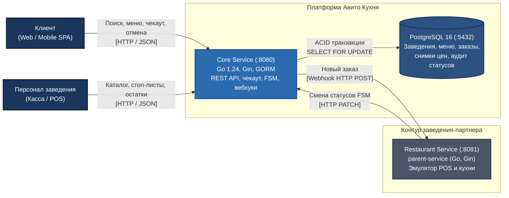
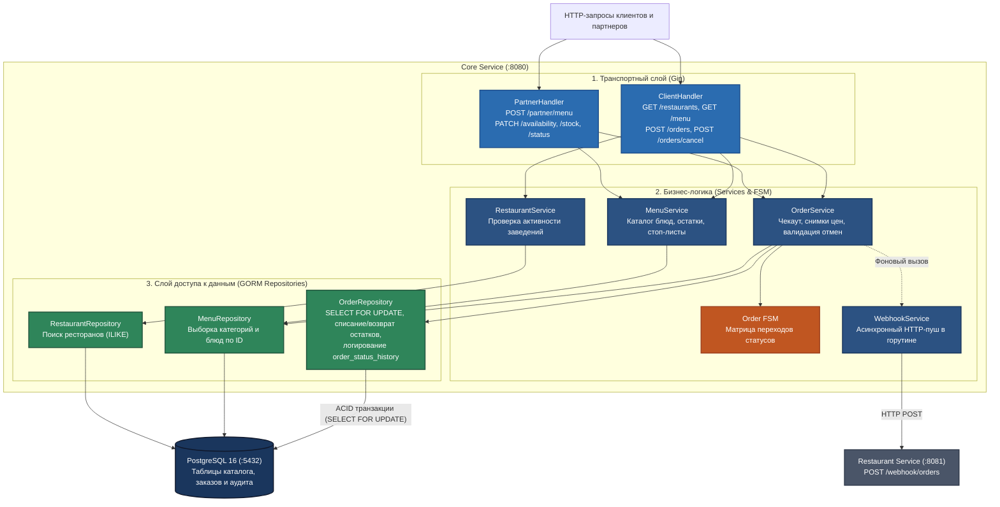
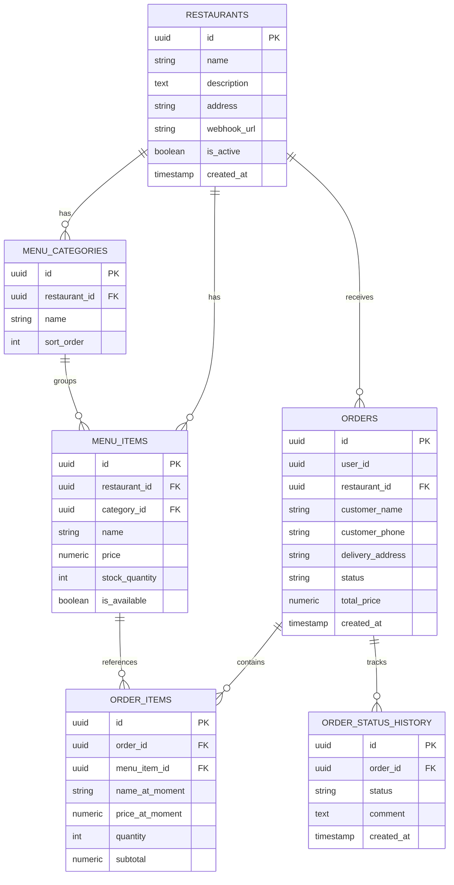
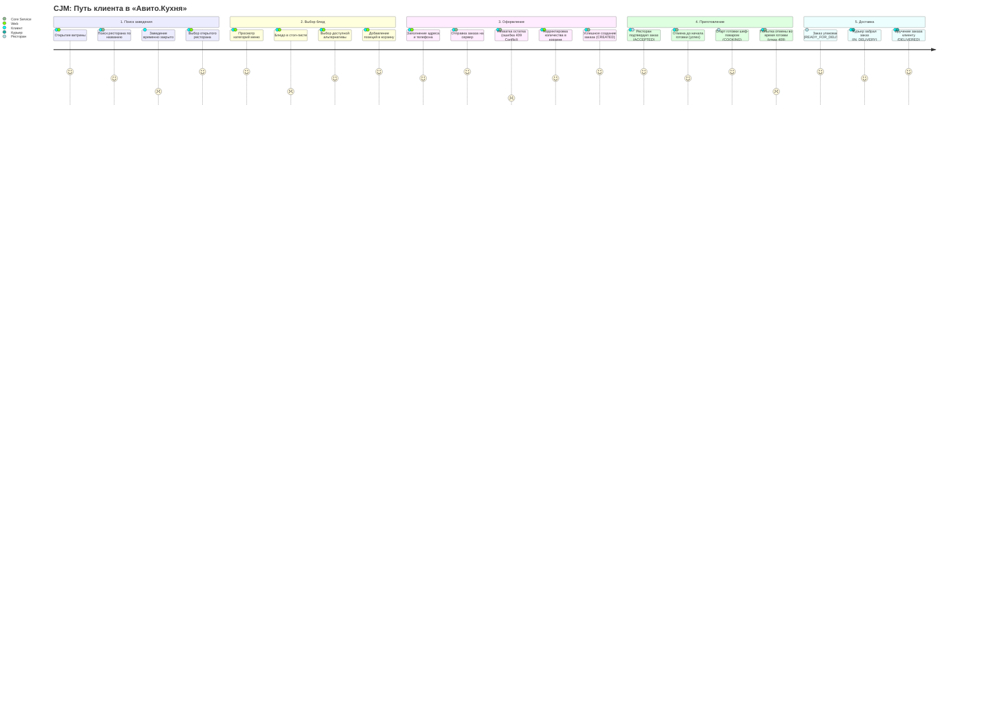
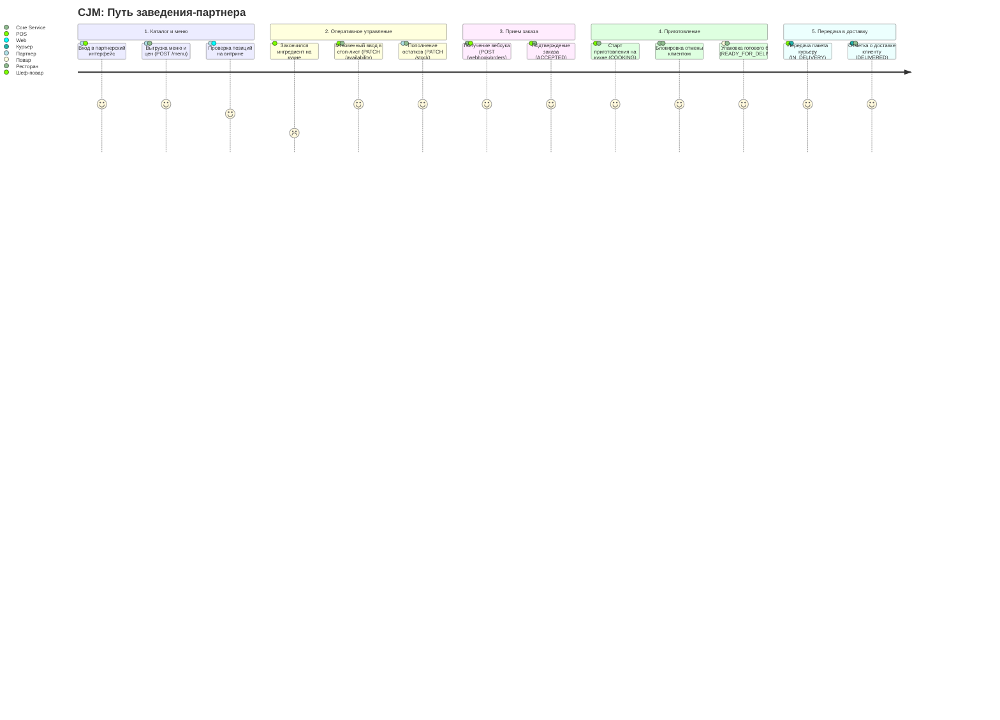

# Авито.Кухня (Avito.Kitchen) — Backend MVP

Бэкенд-сервис платформы заказа и доставки еды из заведений-партнеров для Авито.  
Реализован в рамках тестового задания для стажёра Backend.

---

## 1. Архитектура решения

Система состоит из двух сервисов, запускаемых через Docker Compose:

- **`core-service`** (`:8080`) — ядро платформы: витрина заведений, меню, оформление заказов с транзакционным списанием остатков (`SELECT FOR UPDATE`), контроль жизненного цикла заказа (FSM) и асинхронная отправка вебхуков заведениям.
- **`parent-service`** (`:8081`) — сервис заведения, который принимает входящие вебхуки о заказах, эмулирует этапы приготовления на кухне через фоновые горутины и отправляет обновления статусов обратно в `core-service`.

### Стек:

- **Язык**: Go 1.24 (Gin Web Framework, `log/slog`)
- **База данных**: PostgreSQL 16 (GORM, автоматические миграции)
- **Контракт**: OpenAPI 3.0.3 + встроенный Swagger UI (`/swagger`)
- **Линтер**: `golangci-lint` (конфигурация `.golangci.yml`)
- **Оркестрация**: Docker Compose

---

## 2. Архитектура системы (C4 Model)

Модель архитектуры представлена на уровнях **Level 2 (Containers)** и **Level 3 (Components)**. Все диаграммы выполнены в формате Mermaid.

### 2.1. C4 Level 2: Контейнеры (Containers)

> Исходный файл: [`docs/c4-l2-l3/c4_level2_containers.mmd`](docs/c4-l2-l3/c4_level2_containers.mmd)



### 2.2. C4 Level 3: Компоненты Core Service

> Исходный файл: [`docs/c4-l2-l3/c4_level3_components.mmd`](docs/c4-l2-l3/c4_level3_components.mmd)



---

## 3. Схема базы данных (ERD)

> Исходный файл: [`docs/erd/database_schema.mmd`](docs/erd/database_schema.mmd)



### Ключевые решения схемы:

1. **Снимки цен (`price_at_moment`)**: в `order_items` фиксируется название и цена на момент совершения заказа. Изменение цен рестораном не влияет на оформленные заказы.
2. **Защита от овербукинга (`SELECT FOR UPDATE`)**: при создании заказа строки блюд блокируются в транзакции. При нехватке — откат с ошибкой `409 Conflict`.
3. **Аудит переходов (`order_status_history`)**: все смены статусов заказа логируются со штампом времени и комментарием.

---

## 4. Сценарии взаимодействия (CJM)

Подробное описание матриц шагов, возможных ошибок и логики FSM вынесено в документ [**`docs/cjm/CJM.md`**](docs/cjm/CJM.md).

### 4.1. CJM Клиента (Customer Journey Map)

> Исходный файл: [`docs/cjm/client_journey.mmd`](docs/cjm/client_journey.mmd)



#### Обработка барьеров клиента:

- **Заведение закрыто**: фильтрация `is_active = true`, поиск по подстроке `ILIKE %search%`.
- **Стоп-лист**: флаг `is_available = false` отключает добавление в корзину на фронтенде и блокирует чекаут на бэкенде.
- **Гонка остатков**: блокировка `SELECT FOR UPDATE` гарантирует, что если два клиента одновременно заказывают последний товар, первый оформит заказ, а второй получит `409 Conflict` без списания средств.
- **Окно отмены**: отмена разрешена до начала готовки (`CREATED`, `ACCEPTED`) с автоматическим возвратом остатков на склад. При переходе в `COOKING` отмена блокируется (`409 Conflict`), защищая ресторан от убытков.

---

### 4.2. CJM Заведения-партнера (Partner Journey Map)

> Исходный файл: [`docs/cjm/partner_journey.mmd`](docs/cjm/partner_journey.mmd)



#### Особенности интеграции заведения:

- **Управление меню**: пакетная перезапись каталога через `POST .../menu` в транзакции.
- **Экстренный стоп-лист**: `PATCH .../availability` мгновенно скрывает блюдо из выдачи клиентам.
- **Асинхронные вебхуки**: отправка из фоновой горутины не блокирует чекаут клиента.
- **Резервный механизм**: при сетевых сбоях ресторан может запросить очередь активных заказов через поллинг `GET /api/v1/partner/restaurants/{id}/orders?status=CREATED`.

---

## 5. Спецификация API

- **OpenAPI Контракт**: [`api/openapi.yml`](api/openapi.yml) (OpenAPI 3.0.3).
- **Swagger UI**: доступен по адресу `http://localhost:8080/swagger` (или `/docs`).

> **Инженерное решение по кодогенерации**: На начальном этапе рассматривалось использование генерации `openapi.yml` через Swagger-аннотации в коде (`swag`). Однако в процессе это сильно вызывало постоянную путаницу. Поэтому было принято решение отказаться от кодогенератора и описать контракт вручную в [`api/openapi.yml`](api/openapi.yml) (Contract-First подход), подключив его напрямую к встроенному Swagger UI. Это сохранило чистоту исходного кода и дало полный контроль над деталями контракта и статус-кодами.

### Ключевые эндпоинты:

| Метод   | Путь                                                           | Описание                                     | Заголовок      |
| ------- | -------------------------------------------------------------- | -------------------------------------------- | -------------- |
| `GET`   | `/health`                                                      | Проверка работоспособности сервиса           | —              |
| `GET`   | `/api/v1/restaurants`                                          | Список активных заведений (поиск `?search=`) | —              |
| `GET`   | `/api/v1/restaurants/{id}/menu`                                | Меню заведения по категориям                 | —              |
| `POST`  | `/api/v1/orders`                                               | Оформление заказа клиентом                   | `X-User-ID`    |
| `GET`   | `/api/v1/orders/{id}`                                          | Детали заказа и история статусов             | `X-User-ID`    |
| `POST`  | `/api/v1/orders/{id}/cancel`                                   | Отмена заказа клиентом (до `COOKING`)        | `X-User-ID`    |
| `POST`  | `/api/v1/partner/restaurants/{id}/menu`                        | Синхронизация каталога заведения             | `X-Partner-ID` |
| `PATCH` | `/api/v1/partner/restaurants/{id}/items/{itemId}/availability` | Управление стоп-листом                       | `X-Partner-ID` |
| `PATCH` | `/api/v1/partner/restaurants/{id}/items/{itemId}/stock`        | Изменение остатка блюда                      | `X-Partner-ID` |
| `PATCH` | `/api/v1/partner/orders/{id}/status`                           | Смена статуса заказа по FSM                  | `X-Partner-ID` |

---

## 6. Запуск и проверка

### Запуск через Docker Compose

```bash
docker compose up --build -d
```

Порты сервисов:

- **Core Service**: `http://localhost:8080` (Swagger: `http://localhost:8080/swagger`)
- **Parent Service (Эмулятор)**: `http://localhost:8081`
- **PostgreSQL**: `localhost:5432`

### Команды Makefile

Посмотреть все доступные команды:

```bash
make help
```

```bash
Avito Kitchen Service — команды:

  make build           -- сборка сервисов в бинарники в директории ./bin
  make test            -- запуск модульных тестов с детектором гонок
  make e2e             -- запуск сквозного E2E тестирования (bash сценарии)
  make lint            -- запуск линтера
  make up              -- запуск проекта в Docker Compose
  make down            -- остановка проекта в Docker Compose
  make restart         -- перезапуск проекта в Docker Compose
  make logs            -- просмотр всех логов Docker Compose
  make logs-core       -- просмотр логов core-service
  make logs-parent     -- просмотр логов parent-service
  make clean           -- очистка директории ./bin/
```

---

## 7. Использование ИИ и архитектурный план

Подробный мастер-промпт, декомпозиция архитектурных решений и этапы разработки зафиксированы в документе [**`GEMINI.md`**](GEMINI.md).
