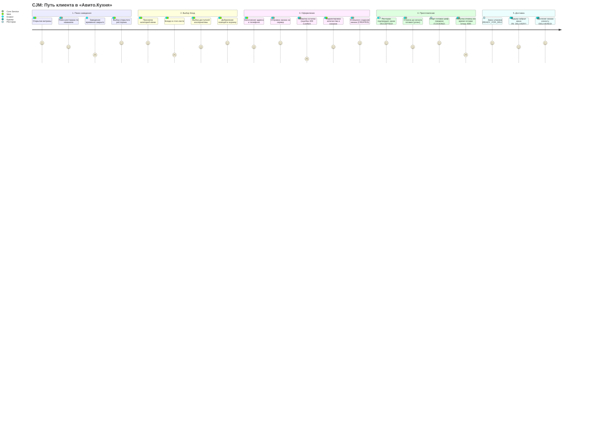
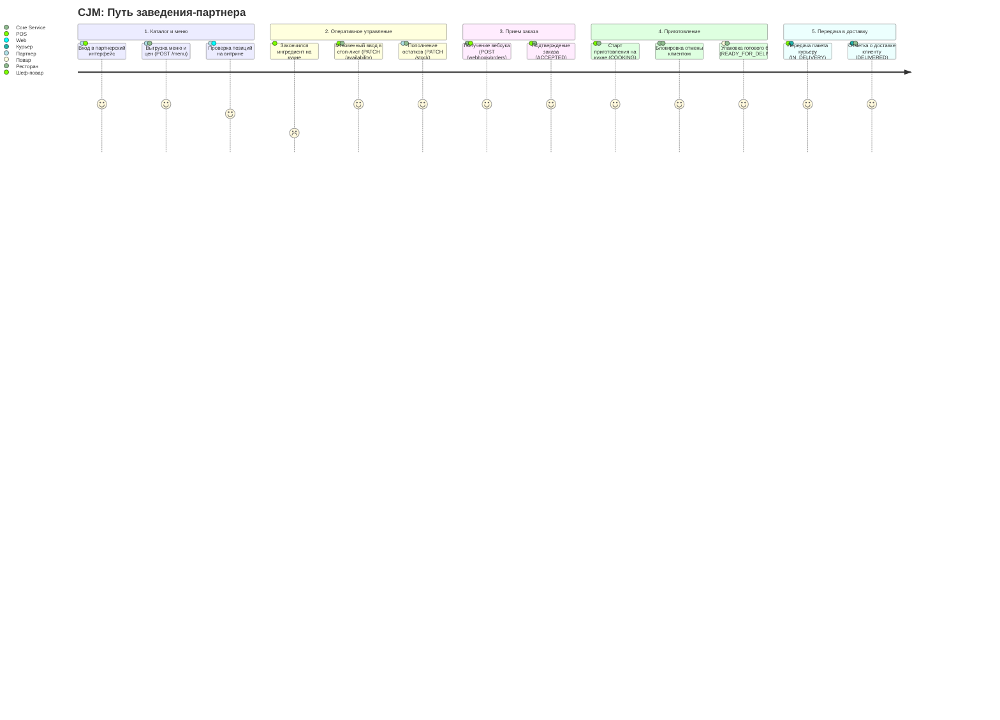

# Customer Journey Maps (CJM) — «Авито.Кухня»

Документ описывает карты пользовательского опыта двух ключевых ролей:

1. **Клиент** — поиск заведения, сбор корзины, чекаут, обработка ошибок наличия товара и отмена.
2. **Заведение-партнер** — выгрузка каталога, оперативные стоп-листы, прием заказов по вебхуку и стадии кухни.

---

## 1. CJM Клиента (Customer Journey Map)

### 1.1. Карта клиентского пути

> Исходный файл: [`client_journey.mmd`](client_journey.mmd)

### 1.2. Матрица этапов и барьеров клиента

| Этап                    | Действие                    | API / Метод                         | Боль / Барьер                                        | Решение системы                                                       | Код ответа     |
| ----------------------- | --------------------------- | ----------------------------------- | ---------------------------------------------------- | --------------------------------------------------------------------- | -------------- |
| **Поиск**               | Поиск ресторана по названию | `GET /api/v1/restaurants?search=`   | Ресторан временно закрыт                             | Фильтрация `is_active = true`, регистронезависимый поиск (`ILIKE`)    | `200 OK`       |
| **Меню**                | Выбор блюд по категориям    | `GET /api/v1/restaurants/{id}/menu` | Блюдо в стоп-листе                                   | Флаг `is_available = false` блокирует кнопку заказа на клиенте        | `200 OK`       |
| **Чекаут**              | Оформление заказа           | `POST /api/v1/orders`               | Гонка остатков: одновременный выкуп последней порции | Транзакционная блокировка `SELECT FOR UPDATE`. При нехватке — откат   | `409 Conflict` |
| **Чекаут**              | Оформление заказа           | `POST /api/v1/orders`               | Изменение цены рестораном во время набора корзины    | Фиксация снимка `price_at_moment` в таблице `order_items`             | `201 Created`  |
| **Отмена (до готовки)** | Отмена заказа клиентом      | `POST /api/v1/orders/{id}/cancel`   | Ошибка в составе или адресе                          | Разрешено в статусах `CREATED` и `ACCEPTED`. Автовозврат остатка в БД | `200 OK`       |
| **Отмена (в процессе)** | Отмена заказа клиентом      | `POST /api/v1/orders/{id}/cancel`   | Еда уже на гриле / в печи                            | Блокировка отмены при `COOKING`+. Защита себестоимости заведения      | `409 Conflict` |
| **Трекинг**             | Контроль статуса            | `GET /api/v1/orders/{id}`           | Непонятно текущее состояние заказа                   | История смены статусов с таймстемпами из `order_status_history`       | `200 OK`       |

---

## 2. CJM Заведения-партнера

### 2.1. Карта пути заведения

> Исходный файл: [`partner_journey.mmd`](partner_journey.mmd)

### 2.2. Матрица этапов и операций заведения

| Процесс          | Действие                  | API / Метод                                  | Риск / Трудность                        | Решение системы                                                                  | Код ответа |
| ---------------- | ------------------------- | -------------------------------------------- | --------------------------------------- | -------------------------------------------------------------------------------- | ---------- |
| **Меню**         | Выгрузка каталога и цен   | `POST /api/v1/partner/restaurants/{id}/menu` | Нарушение связности категорий и блюд    | Пакетная перезапись каталога в единой транзакции БД                              | `200 OK`   |
| **Стоп-лист**    | Снятие блюда с продажи    | `PATCH .../items/{itemId}/availability`      | Поступление заказов без ингредиентов    | Атомарный перевод `is_available = false` с мгновенным скрытием с витрины         | `200 OK`   |
| **Склад**        | Пополнение остатка        | `PATCH .../items/{itemId}/stock`             | Блюдо оставалось скрытым после поставки | При `stock_quantity > 0` флаг `is_available` автоматически сбрасывается в `true` | `200 OK`   |
| **Прием заказа** | Получение заказа на кухню | `POST /webhook/orders` (Webhook)             | Сбой сети / недоступность терминала     | Асинхронный вызов из горутины. Резервный поллинг `GET .../orders?status=CREATED` | `200 OK`   |
| **Кухня**        | Старт приготовления       | `PATCH .../orders/{id}/status`               | Отмена клиентом после начала жарки      | Переход в `COOKING` закрывает окно отмены клиентом                               | `200 OK`   |
| **Выдача**       | Передача курьеру          | `PATCH .../orders/{id}/status`               | Нарушение порядка стадий                | FSM валидирует: `COOKING` ➔ `READY_FOR_DELIVERY` ➔ `IN_DELIVERY` ➔ `DELIVERED`   | `200 OK`   |

---

## 3. Матрица переходов жизненного цикла заказа (FSM)

Валидация выполняется в доменном пакете (`core-service/internal/domain/fsm.go`):

| Текущий статус       | Допустимый следующий статус | Инициатор          | Действие системы                              |
| -------------------- | --------------------------- | ------------------ | --------------------------------------------- |
| `CREATED`            | `ACCEPTED`                  | Ресторан (POS)     | Подтверждение получения заказа                |
| `CREATED`            | `CANCELLED`                 | Клиент             | Возврат списанного `stock_quantity` в БД      |
| `ACCEPTED`           | `COOKING`                   | Ресторан (Кухня)   | Старт готовки. **Блокировка отмены клиентом** |
| `ACCEPTED`           | `CANCELLED`                 | Клиент             | Возврат списанного `stock_quantity` в БД      |
| `COOKING`            | `READY_FOR_DELIVERY`        | Ресторан (Кухня)   | Блюдо упаковано                               |
| `READY_FOR_DELIVERY` | `IN_DELIVERY`               | Курьер / Ресторан  | Передача курьеру                              |
| `IN_DELIVERY`        | `DELIVERED`                 | Курьер / Ресторан  | Вручение клиенту (терминальный статус)        |
| Любой до `DELIVERED` | `CANCELLED`                 | Ресторан / Система | Форс-мажор заведения с возвратом остатков     |
